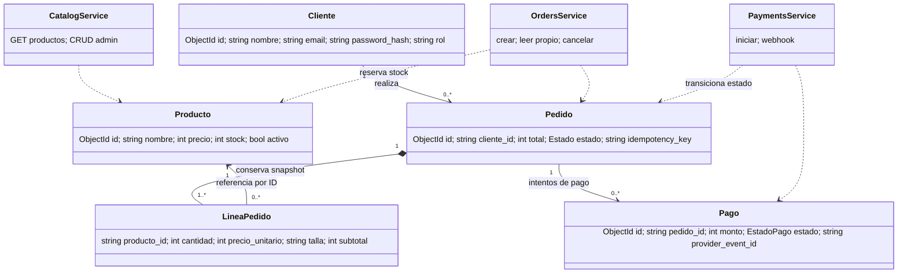
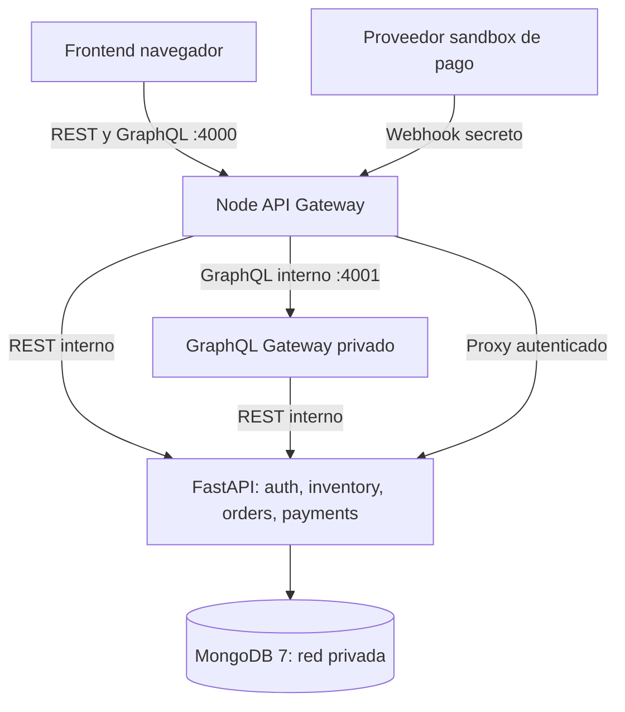
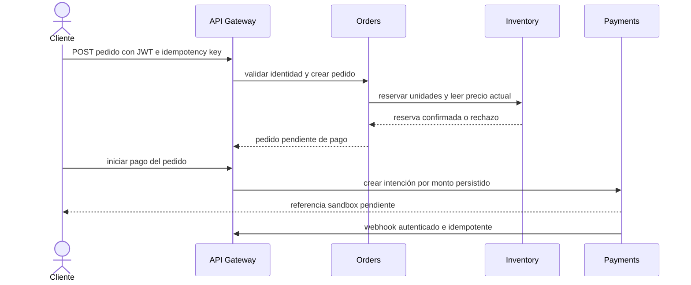
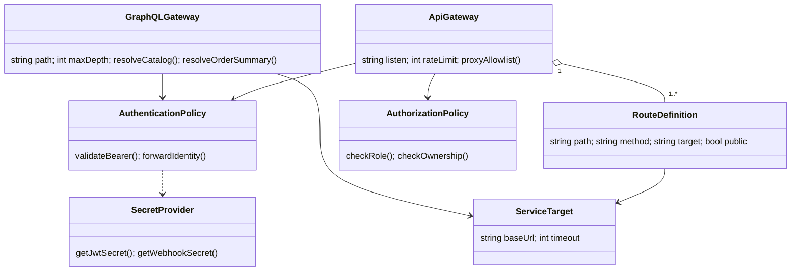

# WEIRD STYLE — Solemne 2: backend y arquitectura

**Caso de trabajo:** tienda de ropa online (referencia del listado: caso 40, “Urban Style”; nombre de la tienda en la interfaz: WEIRD STYLE). **Frontend:** sitio responsivo HTML/CSS/JS ya existente. **Entrega:** rama `solemne2-backend`.

## Alcance y estado honesto

Esta versión conserva el catálogo y el CRUD de productos, agrega registro/login JWT, rol administrador, pedidos con reserva de inventario, pagos sandbox con webhook verificado, un API Gateway REST/GraphQL y pruebas automatizadas. El despliegue Compose mantiene FastAPI y MongoDB en una red sin puertos publicados; solo el gateway Node queda expuesto. Para facilitar el trabajo de curso, los dominios inventory, clients, orders y payments están separados por contratos y colecciones, pero aún son módulos dentro de una aplicación FastAPI y no procesos de microservicios independientes. El componente de boleta electrónica y despacho externo no está integrado: la compra es retiro/entrega informativa y la dirección se conserva en el pedido. No se afirma integración con proveedor de pagos real.

La página integra catálogo vía GraphQL (con fallback REST), registro/login, carrito, creación de pedidos, inicio de pago sandbox, historial y resumen GraphQL por pedido. Los contratos REST también están disponibles en Swagger. La confirmación final del pago la mantiene el webhook servidor-servidor, no el navegador.

## 1. Matriz de servicios y contratos

| ID | Requisito / pantalla y acción | Servicio / ruta | Acceso | Entrada principal | Regla y salida |
|---|---|---|---|---|---|
| S01 | R01 / P01 Catálogo: listar/buscar/filtrar | `GET /productos?q&categoria&skip&limit` | Anónimo | Filtros de catálogo | Solo activos; campos públicos; 200 lista |
| S02 | R01 / P01 Catálogo: detalle | `GET /productos/{id}` | Anónimo | ID de producto | 400 inválido, 404 no existe/inactivo |
| S03 | R02 / P02 Cuenta: registrar | `POST /auth/register` o legado `/clientes/registro` | Anónimo | nombre, email, password | email único; PBKDF2; 201 sin hash, 409 duplicado |
| S04 | R02 / P02 Cuenta: iniciar sesión | `POST /auth/login` o legado `/clientes/login` | Anónimo | email/password | JWT HS256 60 min; 401 credenciales inválidas |
| S05 | R02 / P02 Cuenta: perfil | `GET /auth/me` o legado `/clientes/yo` | Cliente | Bearer JWT | Perfil propio; 401 token inválido/expirado |
| S06 | R03 / P03 Administración: crear producto | `POST /productos` | Admin | producto y stock inicial | 201; cliente: 403 |
| S07 | R03 / P03 Administración: actualizar producto | `PUT /productos/{id}` | Admin | producto completo | 404 si falta |
| S08 | R03 / P03 Administración: baja de producto | `DELETE /productos/{id}` | Admin | ID producto | Baja lógica, mantiene historial |
| S09 | R04 / P04 Checkout: crear pedido | `POST /pedidos` | Cliente | líneas, dirección, idempotency_key | Precio desde Mongo; reserva atómica; 409 stock; 201 pendiente |
| S10 | R05 / P05 Historial: consultar pedidos | `GET /pedidos/mios`, `GET /pedidos/{id}` | Cliente / Admin | JWT e ID | Solo propios para cliente; 403 ajeno; admin lectura |
| S11 | R04 / P04 Checkout: cancelar | `POST /pedidos/{id}/cancelar` | Cliente propietario | ID pedido | Solo pendiente sin pago iniciado; conserva historial y repone stock |
| S12 | R06 / P04 Checkout: iniciar pago | `POST /pagos/pedidos/{id}` | Cliente propietario | `Idempotency-Key` | Monto tomado del pedido; no acepta total del navegador |
| S13 | R06 / Proveedor: confirmar pago | `POST /pagos/webhook/sandbox` | Proveedor | secreto, event_id, payment_id, status | 401 sin secreto; duplicado ignorado; actualiza pedido y stock |
| S14 | R03 / P03 Administración: revisar clientes | `GET /admin/clientes` | Admin | JWT | Campos mínimos; nunca hash |
| S15 | R01 / P01 Catálogo: cargar productos | GraphQL `getProductos` | Anónimo | Consulta GraphQL limitada | Catálogo obtenido de inventory REST |
| S16 | R05 / P05 Historial: resumen agregado | GraphQL `resumenPedido` | Cliente propietario | id + JWT | Agrega orders e inventory; propiedad comprobada en backend |
| S17 | R07 / Diagnóstico: estado | `GET /health`, `GET /ready` | Anónimo / operador | — | Liveness independiente de Mongo; ready 503 si Mongo falla |

### Ejemplo de contrato de compra

```json
{
  "items": [{"producto_id": "665f10000000000000000001", "cantidad": 2, "talla": "M"}],
  "direccion_entrega": "Av. Siempre Viva 123, Santiago",
  "idempotency_key": "orden-2026-00001234"
}
```

El total de respuesta lo calcula el backend consultando los precios vigentes. `idempotency_key` es única por cliente. Se hace una reserva mediante decremento condicional atómico en Mongo. Si una línea falla, se compensa el stock ya reservado. La cancelación solo está permitida antes de iniciar un pago; si el proveedor tiene una intención pendiente se espera su confirmación. El pago rechazado libera stock; pago aprobado lleva el pedido a `pagado` y no se puede cancelar por este endpoint.

## 2. Clases del dominio y cardinalidades



Cada pedido confirmado contiene al menos un detalle. La línea conserva nombre/precio/talla del momento de compra: el producto puede desactivarse, pero no altera el historial. Un pedido puede tener varios intentos de pago; cada pago corresponde a un solo pedido. Carrito no se persiste todavía y se convierte en pedido al enviar S09.

## 3. Sistemas, datos e intercambio

| Sistema | Autoridad de datos | Dependencias | Fallo |
|---|---|---|---|
| clients/auth | correo único, hash de contraseña, rol | JWT secret (variable externa), Mongo | 503 si base no está lista, 401 credenciales inválidas |
| inventory | producto, precio, stock y disponibilidad | Mongo; consulta desde orders | Orden rechazada si no puede reservar; no se confirma stock insuficiente |
| orders | dueño, líneas snapshot, dirección, estado de pedido | inventory para reserva/liberación | compensación de stock si falla escritura; operaciones idempotentes |
| payments | intención, proveedor sandbox, estado, evento procesado | orders; secreto del webhook | no marca pagado por respuesta del frontend; eventos duplicados rechazados |
| API Gateway | rutas externas, CORS, tasa de solicitud | FastAPI y GraphQL privado | timeout, allowlist, error controlado |
| GraphQL Gateway | composición de datos de lectura | orders e inventory REST | profundidad 8; batching por hasta 30 IDs; error de inventory como disponibilidad desconocida |
| MongoDB | persistencia de los dominios | red privada Docker | `/health` reporta `database=down`; APIs transaccionales 503 |

### Mapa de componentes/despliegue



La configuración Compose no publica el puerto 8000 de FastAPI ni el 27017 de Mongo; el gateway es la única entrada de red. La ejecución manual local sí permite acceder a Uvicorn en 8000 para diagnóstico/Swagger.

### Secuencia de compra



## 4. Stakeholders y permisos

| Actor | Interés | Permiso operativo |
|---|---|---|
| Visitante | Explorar prendas | GET catálogo y producto |
| Cliente | Comprar y consultar sus pedidos | Registro/login; pedidos propios; cancelar pendiente; pago por intento propio |
| Administrador de tienda | Mantener catálogo, revisar clientes y pedidos | CRUD producto, clientes de lectura; no se permite borrar clientes |
| Proveedor de pago | Confirmar resultado | Solo webhook con secreto dedicado y evento idempotente |
| MongoDB / servicios internos | Persistencia/operación | Identidad de contenedor; no accesibles desde navegador |
| Equipo académico/docente | Evaluación | Sin permisos operativos; evidencias/documentación |

La API vuelve a comprobar rol y propiedad en cada request. El ocultamiento de elementos visuales no participa en la autorización. El rol `admin` se asigna solo mediante script local de seed, nunca desde el formulario público.

### Matriz resumida de permisos HTTP

| Rol | GET catálogo/producto | POST/PUT/DELETE producto | POST pedido | GET pedido | Cancelar | Iniciar pago | Webhook |
|---|---|---|---|---|---|---|---|
| Visitante | Permitir | Denegar | Denegar | Denegar | Denegar | Denegar | Denegar |
| Cliente | Permitir | Denegar | Permitir autenticado | Solo propietario | Solo propietario, pendiente y sin pago iniciado | Solo propietario | Denegar |
| Admin | Permitir | Permitir con JWT admin | Denegar flujo de compra ajeno | Permitir lectura supervisora | Denegar pedido ajeno | No aplica | Denegar |
| Proveedor sandbox | Denegar | Denegar | Denegar | Denegar | Denegar | No aplica | Permitir solo con secreto y evento válido |

Verificación: endpoint FastAPI y sistema de dominio; GraphQL propaga el Bearer al servicio antes de devolver campos sensibles.

## 5. API Gateway y políticas

El gateway Node (`server.js`, puerto 4000) funciona como proxy REST de allowlist (`/api/auth`, `/api/clientes`, `/api/productos`, `/api/pedidos`, `/api/pagos`, `/api/admin`) y dirige `/graphql` al servicio Node privado (`graphql.js`, puerto 4001), que agrega inventory y orders. Tiene límite de payload 50 KiB, límite simple por IP configurable (`RATE_LIMIT_PER_MINUTE`, por defecto 120), métodos permitidos, CORS por origen y timeout upstream. FastAPI verifica JWT, rol, dueño y reglas de negocio; el gateway no reemplaza esas verificaciones. GraphQL limita profundidad a 8 y oculta introspección en `NODE_ENV=production`. Compose no publica el puerto 4001.

### UML de gateway



Secreto: desarrollo desde variables de entorno, producción desde secret store de la plataforma. Nunca se incluye el valor en documentación, logs o navegador. El pago sandbox usa una credencial de webhook distinta del secreto JWT.

## 6. Rutas y secretos de integración

| Ruta pública | Sistema destino | Credencial | Clasificación |
|---|---|---|---|
| `/api/productos*` | inventory | Anónimo GET; JWT admin para escritura | catálogo público |
| `/api/auth/*`, `/api/clientes/*` | clients/auth | JWT para perfil; registro/login públicos | datos personales restringidos |
| `/api/pedidos*` | orders | JWT cliente/admin y propiedad | dirección, historial restringido |
| `/api/pagos*` | payments | JWT cliente o webhook secret servidor-servidor | transacciones restringidas |
| `/graphql` | GraphQL Gateway | JWT propagado para campos de cliente | según campo solicitado |
| `mongodb://mongodb:27017` | MongoDB | red Docker interna; sin puerto host | almacenamiento restringido |

### Rutas externas y destinos internos

| Gateway / método | Destino interno | Acceso / regla | Identidad del tramo |
|---|---|---|---|
| `GET /api/productos` | FastAPI `GET /productos` | anónimo; filtros escapados y límite 200 | sin secreto para datos de catálogo |
| `GET /api/productos/{id}` | FastAPI `GET /productos/{id}` | anónimo; ID validado | sin secreto |
| `POST /api/auth/register`, `POST /api/auth/login` | FastAPI `POST /auth/...` | anónimo, validación y límite de body | credencial de usuario solo TLS en producción |
| `GET /api/auth/me` | FastAPI `GET /auth/me` | cliente con JWT | JWT bearer verificado contra `JWT_SECRET` |
| `POST/PUT/DELETE /api/productos...` | FastAPI CRUD inventory | solo admin | JWT + rol en servicio |
| `POST /api/pedidos`, `GET /api/pedidos...` | FastAPI orders | cliente autenticado; propiedad validada | JWT de usuario propagado |
| `POST /api/pagos/pedidos/{id}` | FastAPI payments | cliente propietario, idempotency key | JWT + referencia de pedido persistida |
| `POST /api/pagos/webhook/sandbox` | FastAPI webhook | identidad de proveedor; no navegador | `PAYMENT_WEBHOOK_SECRET`, cabecera servidor-servidor |
| `POST /graphql: getProductos` | Resolver → inventory REST | anónimo, campos de catálogo | consulta REST interna |
| `POST /graphql: misPedidos, resumenPedido` | Resolver → orders + inventory REST | JWT y propietario | Bearer verificado por FastAPI en cada recurso |

### Inventario simbólico de secretos e identidades

| Referencia | Emisor/consumidor | Uso y alcance | Ubicación, rotación y revocación |
|---|---|---|---|
| `JWT_SECRET` | operador / servicio clients-auth | firmar/verificar JWT de usuario, HS256 | `.env` local excluido de Git; secret store en producción; rotar invalida tokens actuales |
| `PAYMENT_WEBHOOK_SECRET` | proveedor sandbox / payments | validar solo notificaciones de pago | variable servidor; independiente de JWT; reemplazar en ambos extremos y revocar valor filtrado |
| `MONGODB_URL` | operador / API FastAPI | acceso de la app a Mongo; mínimo usuario/DB en producción | variable de API, nunca de frontend; rotar contraseña en Mongo y reiniciar servicio |
| Identidad `cliente_id` del JWT | auth service / orders y payments | vincular recurso al usuario autenticado | el gateway no acepta encabezados de identidad internos del cliente; reconsulta el sujeto en clients |
| Identidad de contenedor `api` | Docker / Mongo | acceso de proceso backend por red privada | red Compose sin exposición de Mongo; producción debe usar credencial dedicada |

No se comparte una credencial común entre JWT y proveedor de pago. Los valores reales no aparecen en el repositorio. `.env.example` solo contiene marcadores.

Variables: `MONGODB_URL`, `MONGODB_DB`, `JWT_SECRET` (mín. 32 caracteres aleatorios), `PAYMENT_WEBHOOK_SECRET`, `CORS_ORIGINS`, `API_INTERNAL_URL`. `.env.example` trae nombres y marcadores, nunca secretos reales.

## 7. Datos personales y seguridad

Nombre, email, hash y dirección se consideran restringidos. Contraseñas se almacenan como PBKDF2-HMAC-SHA256 con salt aleatoria y costo 600.000; nunca se retornan. El email tiene índice único y se normaliza a minúsculas. JWT expira a los 60 minutos y el algoritmo se fija en HS256. RUN no se solicita. Precios/totales/estado de pago que lleguen desde el browser no son autoritativos. La página nunca captura números de tarjeta; el modo sandbox usa una intención ficticia y confirmación servidor-servidor.

**Secretos propios del cliente: no se custodian.** El cliente no debe entregar claves de integración; las credenciales del proveedor de pagos pertenecen al comercio y quedan solo en el backend. El JWT es una credencial de sesión temporal, no un secreto de integración. El token se mantiene en memoria del navegador y se pierde al recargar/cerrar la pestaña.

| Dato | Uso / clasificación | Custodio y acceso | Frontend / protección / retención |
|---|---|---|---|
| nombre y email | identificación, personales restringidos | clients; cliente dueño, admin en consulta limitada | formularios HTTPS en despliegue real; hash no aplica; se conservan con cuenta y borrado vía administración |
| contraseña | autenticación, credencial | clients-auth solamente | nunca se reenvía tras login; PBKDF2 con salt; se conserva solo el hash mientras exista cuenta |
| dirección | despacho/entrega, personal restringido | orders; cliente propietario y personal admin autorizado | visible solo en sus pedidos; conservar junto con historial del pedido, no en logs |
| historial/estado de pedido | operación comercial, restringido | orders; propietario y admin | consulta autenticada; histórico conservado asociado al cliente |
| producto, precio, stock | catálogo, público limitado | inventory; GET público; mutación solo admin | campos filtrados; baja lógica preserva snapshot de pedidos |
| JWT / webhook secret / URL Mongo | credenciales de sistema | servicios y operador | no renderizar en UI ni logs; variables/secret store; rotar según compromiso |
| tarjeta/pago | dato financiero altamente sensible | proveedor externo; no se recibe ni almacena | el sitio solo guarda referencia sandbox, importe y estado; quedan fuera del alcance local |

La dirección se captura en el checkout, viaja por la ruta autenticada, se guarda en el pedido y vuelve solo al dueño (o admin autorizado). No se registra en logs. El borrado de cliente/historial no tiene pantalla ni política automatizada todavía y debe definirse antes de producción.

Controles incluidos: CORS allowlist, cabeceras defensivas, validación Pydantic, límites de paginación/cantidades, escaping de filtros regex, rate limit y tamaño de body en gateway, rechazo de llamadas no autorizadas, timeout de upstream, logs sin email/token y secretos externos. Para producción faltan HTTPS, secret manager externo, rate limit distribuido, retención/borrado de datos y proveedor de pago certificado.

## 8. GraphQL

`getProductos` resuelve datos desde inventory; `resumenPedido(id)` valida JWT/propiedad consultando orders y agrega disponibilidad/precio vigente desde inventory. El snapshot del pedido sigue siendo la fuente del total cobrado. Campo `precio_actual` es informativo y no recalcula el pedido. El gateway no consulta colecciones Mongo directamente. Duplicidad/no disponibilidad de un producto se representa con `disponible=false` y precio actual nulo. Las mutaciones de catálogo pasan por REST y requieren rol admin. El front carga `getProductos` con REST como respaldo en caso de gateway apagado.

## 9. ADR: analítica y gRPC

**ADR-001 — No desplegar gRPC ni almacén analítico para la Solemne 2 actual.**

- Contexto: storefront académico con catálogo pequeño y compras unitarias; flujos de checkout requieren respuesta inmediata y agregados pequeños. No hay flujo continuo, procesamiento intensivo ni un volumen medido que justifique streaming o almacenamiento analítico.
- Alternativas: REST entre dominios con GraphQL de lectura; gRPC unary; gRPC streaming + servicio analítico y pipeline.
- Decisión: mantener REST síncrono y GraphQL para composición de lectura. La agregación de pedido combina dos sistemas y es baja en volumen. No guardar datos personales en un almacén analítico.
- Consecuencias: menos operación y despliegue; no se atribuye una mejora de rendimiento a gRPC. Se medirá con `scripts/load_smoke.py` sobre `/health` y `/productos` en un entorno con Mongo/Compose. Si carga medida supera límites o aparece procesamiento de eventos, se revisará el ADR. La prueba de carga y sus métricas no se deben presentar como ejecutadas hasta correrla en el equipo con Mongo activo.

## 10. Pruebas y ejecución

Pruebas automatizadas actuales: salud/docs sin Mongo; CORS POST; registro duplicado; login/perfil; denegación de CRUD a cliente; stock atómico; control de propiedad; total calculado en servidor; webhook aprobado/duplicado y rechazo sin secreto. La integración Node verifica que `resumenPedido` agregue orders e inventory y propague JWT. Ejecución en este workspace: 3 pruebas API simuladas y 1 prueba del gateway aprobadas.

```bash
# Windows PowerShell: crear .env a partir de .env.example y generar secretos aleatorios fuera del repositorio
# Iniciar Mongo + API Gateway
Docker compose up --build
# Frontend: abrir frontend/index.html con Live Server (puerto 5500)
# Swagger local solo con modo manual: uvicorn main:app --host 127.0.0.1 --port 8000 --reload (desde api-python)
# Tests
python -m pip install -r api-python/requirements.txt
python -m pip install pytest mongomock-motor
python -m pytest api-python/tests -q
npm test
```

Docs: `http://127.0.0.1:8000/docs` en modo manual; `http://127.0.0.1:4000/graphql` como gateway Compose. No se recomienda levantar API y Mongo en dos equipos/entornos distintos sin cambiar `MONGODB_URL`.

### Diagnóstico del problema reportado

`Application startup complete` significa que Uvicorn inició la app, pero no demuestra que Chrome esté mirando la misma máquina/puerto. En el código previo, `/docs` se creaba automáticamente y `/health` no tenía dependencia de Mongo; CORS no puede bloquear que se abra Swagger. En máquina local se ejecuta con `uvicorn main:app --host 127.0.0.1 --port 8000 --reload` y Chrome abre `http://127.0.0.1:8000/docs`. Si VS Code usa SSH, WSL, Codespaces o un contenedor, `127.0.0.1` de Chrome es el PC local, no el entorno remoto: en ese caso ejecuta con `--host 0.0.0.0`, abre **Ports**, reenvía 8000 y usa la URL que muestra VS Code. Si falla `/health`, confirma que `netstat -ano | findstr :8000` muestra el PID de Uvicorn y que otro proceso/firewall no ocupa el puerto. Mongo no debe impedir `/health` ni `/docs`; `/ready` muestra el estado de base.

## Brechas pendientes de cierre de rúbrica

- Ejecutar pruebas de integración reales con Mongo de Docker y capturar resultados del entorno local del equipo.
- Capturar evidencia visual de los formularios de registro/login/checkout e historial al ejecutar la tienda local.
- Administración de catálogo/clientes funciona como API protegida y Swagger; aún no existe una pantalla de administración propia.
- Despliegue separado de los cuatro microservicios como procesos/servicios; ahora son módulos dentro de FastAPI.
- Integración de proveedor de pago real de prueba, boleta electrónica, despacho y comprobantes cuando lo exija el caso elegido.
- Adjuntar los diagramas Mermaid como fuente editable o exportarlos al formato solicitado por el equipo docente.
